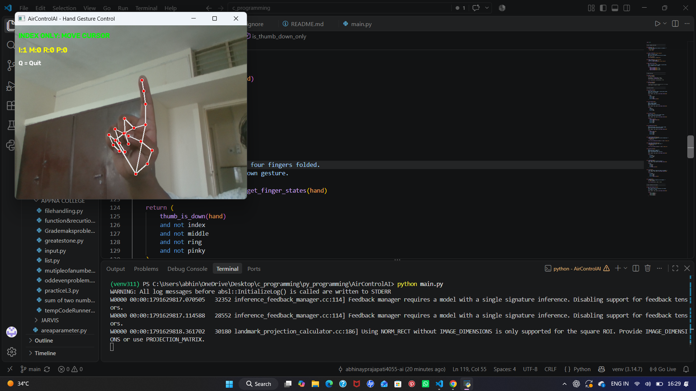

# 🖐️ AirControlAI — Hand Gesture Control

Control your computer using hand gestures and your webcam! AirControlAI is a Python-based computer vision project designed to make computer interaction more natural and accessible.

## ✨ Features
## 📸 Project Preview

  
* 🖱️ **Cursor Movement** — Move the mouse cursor using your index finger.
* 📜 **Scrolling** — Use hand gestures to scroll.
* 🔊 **Volume Control** — Control system volume using supported hand gestures.
* 👆 **Mouse Actions** — Perform supported clicks and other mouse actions using gestures.
* 🎥 **Real-Time Detection** — Detect hand landmarks through your webcam.
* 🖥️ **Live Gesture Feedback** — Display recognized gestures on the webcam window.

> **Note:** Available gestures depend on the implementation in `main.py` and `gesture.py`.

## 🛠️ Technologies Used

* Python
* OpenCV
* MediaPipe
* PyAutoGUI

## 📋 Requirements

* Windows, macOS, or Linux (some controls may be platform-dependent)
* Python installed
* A working webcam
* Git

## 🚀 Installation

### 1. Clone the repository

```bash
git clone https://github.com/abhinayprajapati4055-ai/hand-gesture-control-.git
```

### 2. Open the project folder

```bash
cd hand-gesture-control-
```

### 3. Create a virtual environment

**Windows:**

```powershell
python -m venv venv
```

### 4. Activate the virtual environment

```powershell
.\venv\Scripts\Activate.ps1
```

### 5. Install the required libraries

```powershell
python -m pip install opencv-python mediapipe pyautogui
```

> If MediaPipe installation fails, check the Python and MediaPipe compatibility requirements for your environment.

### 6. Run AirControlAI

```powershell
python main.py
```

Make sure your webcam is connected and available.

## 🖐️ Gesture Controls

AirControlAI recognizes hand gestures to perform computer actions. The exact mapping depends on the current code.

Examples of supported controls include:

| Action        | Purpose                                                    |
| ------------- | ---------------------------------------------------------- |
| Index finger  | Move the cursor                                            |
| Two fingers   | Scroll                                                     |
| Thumb gesture | Scroll or control volume, depending on the recognized pose |
| Pinky gesture | Perform a supported mouse action                           |
| Open palm     | Perform a supported action                                 |
| Fist          | Perform a supported action                                 |
| Pinch gesture | Perform a supported mouse action                           |

Refer to `main.py` and `gesture.py` for the exact gesture definitions.

## 📁 Project Structure

```text
hand-gesture-control-/
├── main.py
├── gesture.py
├── README.md
└── requirements.txt
```

## 🔒 Privacy

AirControlAI uses your webcam for local hand detection. Webcam access and computer-control permissions are required for the relevant features to work.

Review the code before running it, especially because mouse automation can interact with other applications.

## 🔮 Future Improvements

* Improve gesture recognition accuracy.
* Reduce cursor movement latency.
* Add more customizable gestures.
* Improve accessibility and usability.
* Add screenshots and a demonstration video.

## 🤝 Contributing

Suggestions and improvements are welcome!

1. Fork this repository.
2. Create a branch for your changes.
3. Make your improvements.
4. Submit a pull request.

## 👨‍💻 Author

**Abhinay Prajapati**

GitHub: [@abhinayprajapati4055-ai](https://github.com/abhinayprajapati4055-ai)

## ⭐ Support

If you find AirControlAI interesting, consider giving the repository a star ⭐ on GitHub.

---

*Built with Python, computer vision, and curiosity.*
